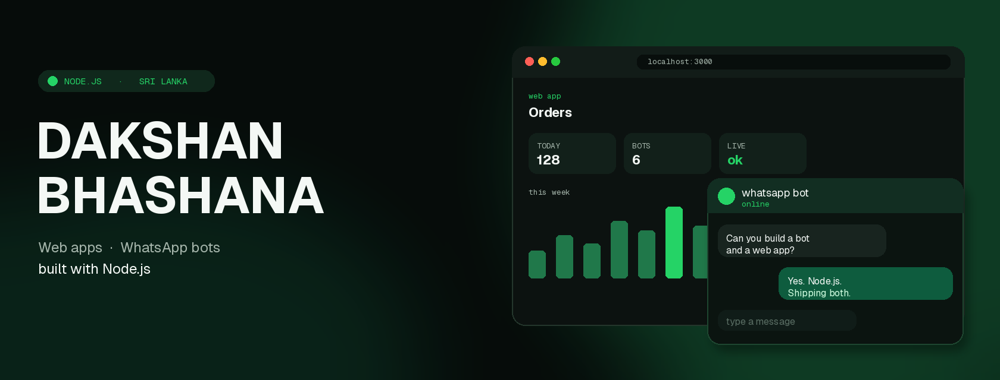
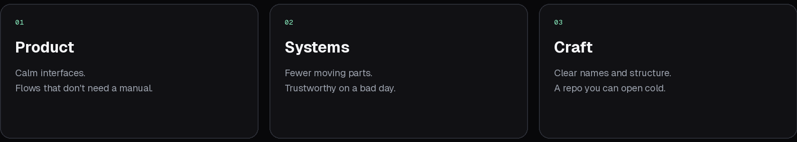

  

  

I'm **Dakshan Bhashana**. I build software that stays clear when it gets real — fast where a person can feel it, and finished before it ships.

පැහැදිලිව හදනවා. අවසන් කරලා දෙනවා.

### How I work

- Start from the person using it, not the framework.
- One sharp tool over a large, vague one.
- Ship, then refine.
- Write so the next reader doesn't have to guess.

**Now** — this profile is the front door. New work shows up in the repos beside it.

  Sri Lanka &nbsp;·&nbsp; clear &nbsp;·&nbsp; fast &nbsp;·&nbsp; finished

