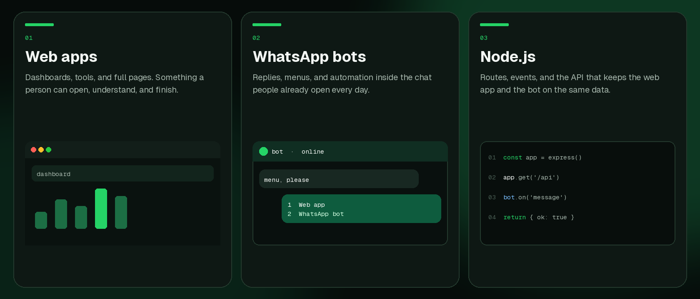
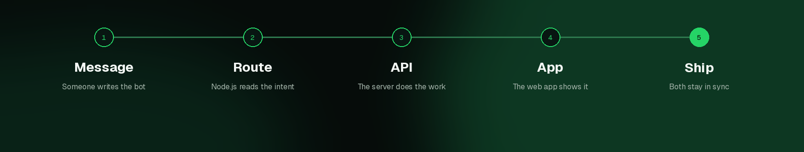
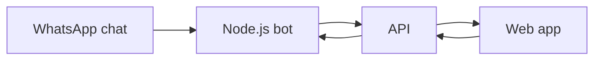
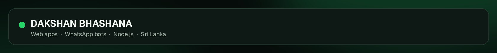

<div align="center">


<br>


<br>


</div>

## About

I'm **Dakshan Bhashana**, a developer in Sri Lanka. I build **web apps** and **WhatsApp bots**, and I build both with **Node.js**.

A web app is where the work is visible. A WhatsApp bot is where the work is easy to reach. Node.js is the piece that listens, decides, and answers. The projects I care about are those three working as one product: a person sends a message, the server does something useful, and the web app shows what happened.

```javascript
const dakshan = {
  name: "Dakshan Bhashana",
  based: "Sri Lanka",
  builds: ["Web apps", "WhatsApp bots", "Node.js backends"],
  stack: ["JavaScript", "Node.js", "Express", "HTML", "CSS"],
  currently: "Shipping the app and the bot together",
};
```

## What I build



### Web apps

Pages with a job. Dashboards, small tools, and screens a person can open without a tour. I care about a clear first view, obvious actions, and a layout that still makes sense after the data gets messy.

### WhatsApp bots

Bots that live in the chat people already use. Menus, replies, and small automations, so a task can be done without asking someone to install another app or learn another site. The bot should feel quick, and it should say what it is doing.

### Node.js

The server under both. Routes, events, and the API that keeps the web app and the bot on the same facts. If the bot accepts an order, the app should be able to show it. If the app changes something, the bot should be able to say so.

## How a piece of work moves



1. **Message.** Someone writes the bot in plain language, or taps a menu.
2. **Route.** Node.js reads the message and decides what it is asking for.
3. **API.** The server does the real work: look something up, save it, or change it.
4. **App.** The web app shows the same thing, so it is not trapped inside one chat.
5. **Ship.** Both sides stay in sync, and the next change is smaller than the last one.



## Stack

<div align="center">

**Language and runtime**


**The page**


**Tools**


</div>

| Layer | What I use it for |
| --- | --- |
| **JavaScript** | The language across the bot, the server, and the page. |
| **Node.js** | The runtime. Long-running bots, HTTP servers, and the glue between them. |
| **Express** | Routes and APIs. A small surface the web app and the bot can both call. |
| **HTML and CSS** | The visible part of a web app. Structure first, then a screen that stays calm. |
| **Git and npm** | History, packages, and a project someone else can install. |

## How I work

- Start from the person who will use it. A bot command and a page button should name the same job.
- Keep the server small. One clear route is better than five clever ones.
- Make the bot say what happened. Silence feels like a bug.
- Make the web app show the same state the bot just changed.
- Ship a thin version, then add the next command or the next screen.
- Leave the repository readable. The next person to open it should not need a tour.

## Now

This profile is the front door. New web apps and WhatsApp bots show up in the repositories next to it as they ship.

If you are looking at a project here, start with the README in that repo. It should say what the app does, how the bot fits, and how to run the Node.js side.

<div align="center">



</div>
